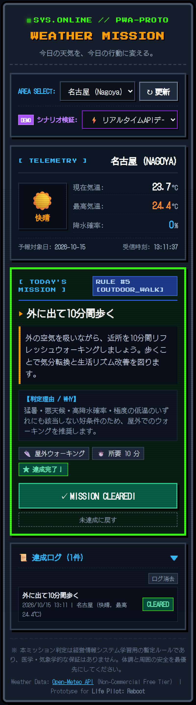
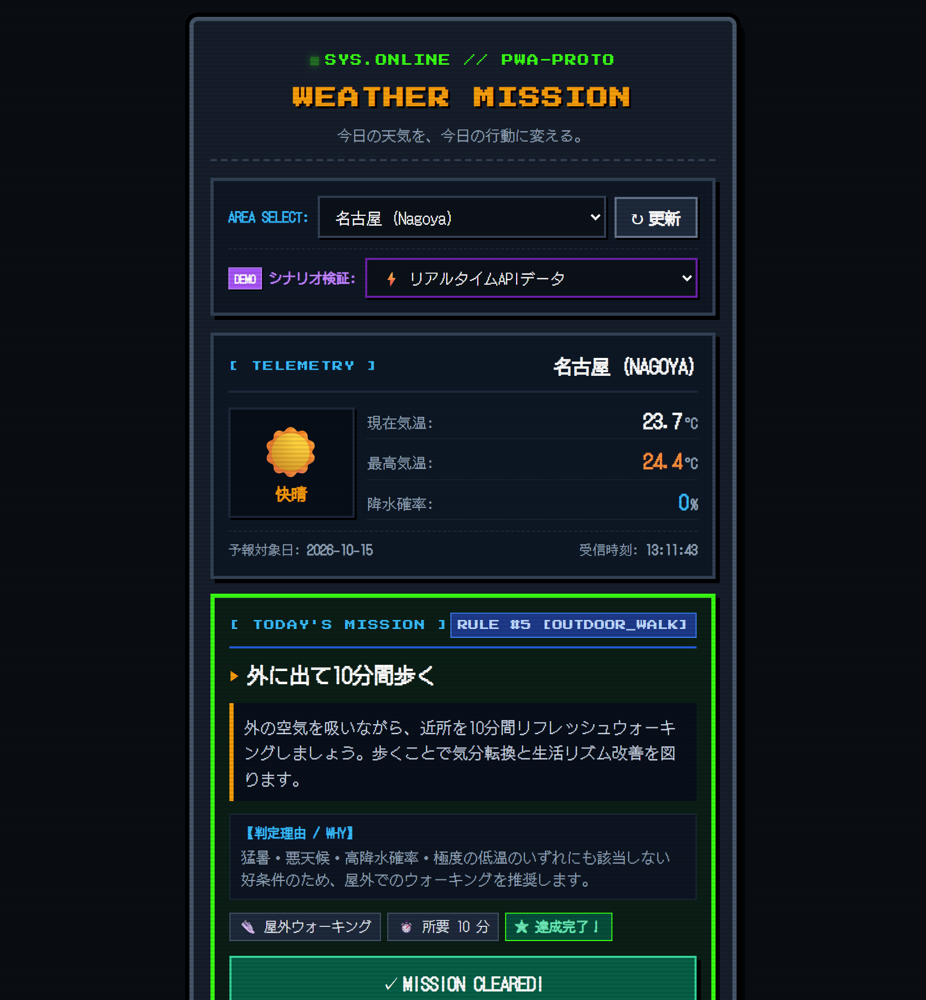

<!-- _class: lead -->

LIFE PILOT PROJECT

# Life Pilot: Reboot

## スマホに自分を操縦させる、生活リズムハック

天気と気分に合わせて、今日の行動をミッションに変えるPWA

---

# 1. 解決したい課題

<h3>意志力に頼りすぎる</h3>
やる気がある日だけ行動できる。疲れている日は、最初の一歩が重い。

<h3>天候と体調を無視する</h3>
晴天の日と大雨の日で同じ行動を選ぶと、無理や失敗につながる。

<h3>習慣が単調になる</h3>
正しい行動でも、毎日同じだと飽きて続きにくい。

<strong>着眼点：</strong>「頑張る」仕組みではなく、次にやることを小さく具体化し、ゲームとして開始できる仕組みにする。

---

# 2. コンセプト

<h3>利用者は「機体」</h3>

その日の気分を選ぶと、パイロット人格が変わり、強さや語り口が変化する。

<h3>生活改善を「バトル」にする</h3>

行動をミッション化し、HP・シンクロ率・サボりへのツケで結果を可視化する。

---

# 3. アプリの使い方

① 起動<b>›</b>② 気分を選ぶ<b>›</b>③ 指令を確認<b>›</b>④ 集中する<b>›</b>⑤ 達成

<h3>入力</h3><ul><li>気分：不調／通常／絶好調／サボり期</li><li>地域または現在地</li><li>必要ならAI候補の条件</li></ul>

<h3>出力</h3><ul><li>天気に合った行動</li><li>所要時間と理由</li><li>人格らしいメッセージ</li></ul>

---

# 4. UI設計：ゲームの導線をそのまま使う

<strong>タイトル</strong>：起動する理由をつくる

<strong>コンディション</strong>：自分の状態を選ぶ

<strong>ミッション指令</strong>：行動を一つに絞る

<strong>集中タイマー</strong>：実行中の状態を見せる

<strong>達成画面</strong>：次の行動につなげる

---

# 5. 天気からミッションを決める

<h3>Open-Meteo API</h3>
現在気温、最高気温、天気コード、降水確率を取得する。

APIキー不要。都市選択とブラウザの現在地に対応。

<h3>安全優先の固定ルール</h3><ol><li>猛暑：室内ストレッチ</li><li>大雨・雷雨：屋外行動を避ける</li><li>高降水確率：室内運動</li><li>寒冷：軽いウォームアップ</li><li>その他：屋外ウォーキング</li></ol>

<strong>設計判断：</strong>天気APIの結果から安全性を含む基本ミッションを先に決め、AIはその範囲内で候補や表現を補助する。

---

# 6. AIの役割

天気・気分・ステータス<b>→</b>Cloudflare Worker<b>→</b>Gemini API<b>→</b>ミッション候補

<h3>現在の実装</h3><ul><li>AI候補のタイトル・説明・理由・時間を生成</li><li>最大3件に制限</li><li>カテゴリと所要時間を検証</li></ul>

<h3>今後の拡張</h3><ul><li>教官・鬼軍曹・マッドサイエンティストなどの人格文</li><li>音声読み上げ用の短い指令</li><li>達成状況に応じたセリフ</li></ul>

Gemini APIキーはGitHub Pagesに置かず、Cloudflare WorkerのSecretとして管理する。

---

# 7. 技術構成

<h3>フロントエンド</h3>
HTML / CSS / Vanilla JavaScript Marpと同じレトロピクセル表現 LocalStorageでプロフィールと履歴を保存

<h3>外部API</h3>
Open-Meteo：天気 Gemini：候補・人格表現 Cloudflare Worker：APIキー保護

<h3>端末機能</h3>
Geolocation：現在地 DeviceMotion：シェイク SpeechSynthesis：読み上げ Vibration：フィードバック

---

# 8. 安全性とプライバシー

<h3>安全性</h3><ul><li>AIの出力をクライアントとWorkerの両方で検証</li><li>危険な天候時の屋外行動を拒否</li><li>所要時間を3〜30分に制限</li><li>AI停止時は固定ミッションへ戻す</li></ul>

<h3>プライバシー</h3><ul><li>現在地は天気取得のためだけに利用</li><li>座標をLocalStorageへ保存しない</li><li>Geminiキーをブラウザへ出さない</li><li>端末センサーはユーザー操作時だけ利用</li></ul>

---

# 9. 現在の実装状況

実装済み

<ul><li>レトロRPG風の画面遷移</li><li>天気取得・デモシナリオ</li><li>気分と人格の切り替え</li><li>ミッションタイマー</li><li>達成履歴とステータス更新</li><li>現在地取得のエラー処理</li></ul>

接続準備済み

<ul><li>Cloudflare Worker</li><li>Gemini API呼び出し</li><li>APIキーのSecret管理</li><li>AI候補の安全検証</li></ul>

残作業：Worker URLとGemini APIキーを設定して本番接続する。

---

## 現在の実装に合わせた更新

<h3>コンディション連動</h3><ul><li>不調：室内5分リカバリー</li><li>ふつう：天候に合わせた標準ミッション</li><li>絶好調：20分ブーストウォーク</li><li>サボり気味：室内5分ツケ回収</li></ul>

<h3>AI指令生成</h3><ul><li>安全な基本ミッションを先に決定</li><li>Geminiがタイトル・説明・理由を具体化</li><li>失敗時は固定ミッションへフォールバック</li></ul>

天気・気分<b>→</b>安全判定<b>→</b>Gemini指令<b>→</b>実行

<strong>設定画面のAIミッション候補</strong>：場所・時間を指定して最大3件の候補を生成し、選択した候補を実行できます。APIが利用できない場合も通常ミッションは継続します。

設定からホームへ戻る画面遷移も修正済み。APIキーはCloudflare Worker側で管理し、ブラウザには公開しません。

---

# 10. 今後の方針

<h3>生活リズム</h3>
起床・就寝時刻、固定タスク、連続達成日数を追加する。

<h3>介入体験</h3>
人格によるリアルタイム指令、読み上げ、通知、水平設置判定を追加する。

<h3>成長要素</h3>
人格の解放、シンクロ率による態度変化、サボりへのツケの演出を強化する。

ブラウザのバックグラウンド処理やiOSのセンサー制約を考慮し、常時監視ではなくユーザーが開始したミッション単位で実装する。

---

<!-- _class: lead -->

# まとめ

## Life Pilot: Rebootは、生活改善を「続けられるゲーム」に変える

天気<b>＋</b>気分<b>＋</b>安全ルール<b>＋</b>AI人格

次にやることを小さくし、行動の開始を楽しくする。

参考：Open-Meteo API / Google Gemini API / Cloudflare Workers

