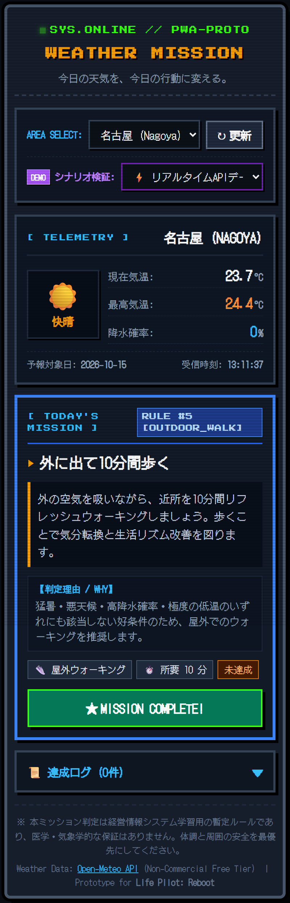
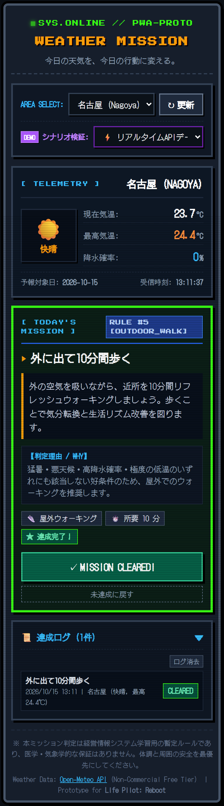
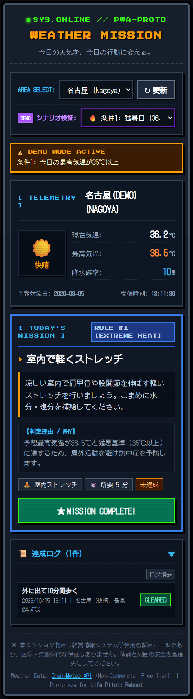
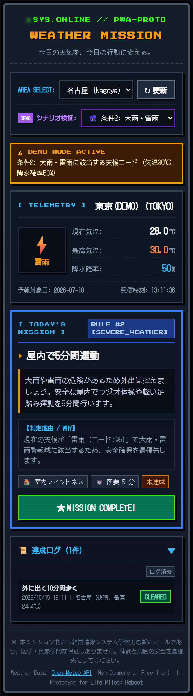

<!-- 
_class: lead
_paginate: false
-->

# Weather Mission
## APIを活用した生活改善ミッション提案アプリの開発
### ― 卒業制作「Life Pilot: Reboot」への応用 ―

  

    
<strong>発表者</strong>: 名古屋市立大学 経済学部 ゼミ生

    
<strong>領域</strong>: 経営情報システム（MIS）/ API実習 / 卒業制作先行開発

    

      <strong style="color: #fbbf24; font-size: 1rem;">コンセプト</strong> 
      「今日の天気を、今日の行動に変える。」
    

    

      外部気象データを解析し、環境に合わせた最適な生活行動を即座に提案する1画面完結型レトロWebアプリ。
    

  

  

    
  

<!--
【発表者ノート】（目安: 40秒）
皆さんこんにちは。本日は「Weather Mission — APIを活用した生活改善ミッション提案アプリの開発」について発表します。
本プロジェクトは、外部気象APIから取得したデータを単に画面表示するにとどまらず、利用者の「今日の具体的な行動」へと変換する意思決定支援アプリです。
卒業制作として構想しているレトロゲーム風生活改善PWA『Life Pilot: Reboot』のコア機能の先行開発として制作しました。
-->

---

# 1. 制作の背景と3つの目的

経営情報システム（MIS）の視点から、外部データを活用する一連の流れを実践

  

    <h3>① REST APIの体得</h3>
    
HTTP GET、エンドポイント、パラメータ、JSON構造の抽出をコードで一気通貫に体験する。

    技術の基礎
  

  

    <h3>② 外部データの行動活用</h3>
    
「データを取得して終わり」ではなく、条件分岐により<strong>具体的な生活改善行動</strong>へ変換する。

    MISの視点
  

  

    <h3>③ 卒業制作の先行開発</h3>
    
卒制『Life Pilot』の「環境センサー部」および「安全な行動選定エンジン」を先行して検証する。

    実用プロトタイプ
  

  📖 <strong>参考教材</strong>：河合勝彦先生（2026年10月9日） 
  ・『Webアプリ開発に役立つAPI利用ガイド Pythonとuvで試す94のAPI』 
  ・『システム連携の基礎 REST APIを使ったデータ取得と業務改善』

<!--
【発表者ノート】（目安: 40秒）
制作の背景と目的は大きく3点あります。
第1に、REST APIの仕組みを実際にブラウザやJavaScriptから直接呼び出して深く理解すること。
第2に、経営情報システムの講義で学んだ「外部データを判断に活かす」という視点を自ら形にすること。
そして第3に、卒業制作で予定しているAI生活改善PWA『Life Pilot』の意思決定コアエンジンを先行開発することです。
-->

---

# 2. Weather Mission とは？

**1画面完結型・直感的な行動提案サイクル**

  

    <ol style="line-height: 1.8; font-size: 0.9rem;">
      <li><strong>地域選択</strong>: 名古屋・東京・大阪から選択（またはワンクリック更新）</li>
      <li><strong>API通信</strong>: Open-Meteo から最新の気象テレメトリを非同期取得</li>
      <li><strong>ルール判定</strong>: 気温・天候・降水確率を評価し1件のミッションを選定</li>
      <li><strong>ミッション提示</strong>: 行動指示・所要時間・選定理由（WHY）を表示</li>
      <li><strong>達成・ログ記録</strong>: 完了ボタンでLocalStorageへ実績保存</li>
    </ol>
    

      世界観 オリジナル・レトロ携帯端末 / RPG風UI 
      文字視認性・コントラスト・スマホ優先レスポンシブに配慮
    

  

  

    
  

<!--
【発表者ノート】（目安: 45秒）
こちらがアプリの全体像です。
利用者が都市を選択すると、Open-Meteo APIにGETリクエストを送信。受信した気温や降水確率から、事前に定義した優先順位ルールで本日のミッションを決定します。
画面には「なぜそのミッションが選ばれたのか」という選定理由（WHY）が明記され、ユーザーは納得して行動できます。
完了ボタンを押すと、即座にLocalStorageへログが記録されます。
-->

---

# 3. 利用APIと非同期通信の仕組み

**Open-Meteo Weather Forecast API** を `fetch()` / `async-await` で安全に呼び出し

  

    

      // weather.js: GET リクエスト送信 
      const url = `https://api.open-meteo.com/v1/forecast?latitude=${city.lat}&amp;longitude=${city.lon}&amp;current=temperature_2m,weather_code&amp;daily=temperature_2m_max,precipitation_probability_max&amp;timezone=Asia%2FTokyo&amp;forecast_days=1`; 
      const res = await fetch(url, { signal: controller.signal });
    

    <ul style="font-size: 0.78rem; line-height: 1.6; margin-top: 8px;">
      <li><strong>認証不要</strong>: APIキー不要でフロントエンド公開でも漏洩の懸念なし</li>
      <li><strong>タイムアウト制御</strong>: <code>AbortController</code> (8000ms) で接続障害を遮断</li>
      <li><strong>HTTP例外処理</strong>: <code>res.ok</code> 判定でステータスエラーを捕捉</li>
    </ul>
  

  

    

      // 取得JSONの抽出と整形 
      { 
      &nbsp;&nbsp;"current": { "temperature_2m": 23.8, "weather_code": 0 }, 
      &nbsp;&nbsp;"daily": { 
      &nbsp;&nbsp;&nbsp;&nbsp;"time": ["2026-10-15"], 
      &nbsp;&nbsp;&nbsp;&nbsp;"temperature_2m_max": [24.4], 
      &nbsp;&nbsp;&nbsp;&nbsp;"precipitation_probability_max": [0] 
      &nbsp;&nbsp;} 
      }
    

    

      現在値（current）と日別予報（daily）を正しく区別して抽出し、アプリ内部形式に変換。
    

  

<!--
【発表者ノート】（目安: 45秒）
通信部分には、世界気象機関のデータを無償提供しているOpen-Meteo APIを採用しました。
APIキーが不要なため、GitHub Pagesなどのフロントエンド単体公開でもセキュリティ上の秘密情報漏洩リスクがありません。
JavaScriptのfetchとasync/awaitを用い、AbortControllerによる8秒タイムアウトや、HTTPステータス検査、日別配列の整合性チェックを行っています。
-->

---

# 4. ミッション判定の仕組み（条件分岐）

**優先度の高い健康・安全条件を優先する決定的アルゴリズム (`mission.js`)**

<table>
  <thead>
    <tr>
      <th style="width: 10%;">優先度</th>
      <th style="width: 25%;">判定条件</th>
      <th style="width: 30%;">提案ミッション</th>
      <th style="width: 35%;">判定理由（設計意図）</th>
    </tr>
  </thead>
  <tbody>
    <tr>
      <td style="text-align: center;"><strong style="color: #ef4444;">1</strong></td>
      <td>最高気温 35℃ 以上</td>
      <td><strong>室内で軽くストレッチ</strong> (5分)</td>
      <td>熱中症リスク回避。屋外活動を制限</td>
    </tr>
    <tr>
      <td style="text-align: center;"><strong style="color: #f59e0b;">2</strong></td>
      <td>大雨・雷雨コード <small>(WMO 65, 82, 95 等)</small></td>
      <td><strong>屋内で5分間運動</strong> (5分)</td>
      <td>気象警報レベルの危険天候から避難</td>
    </tr>
    <tr>
      <td style="text-align: center;"><strong style="color: #38bdf8;">3</strong></td>
      <td>最大降水確率 60% 以上</td>
      <td><strong>室内で10分間運動</strong> (10分)</td>
      <td>雨に降られるリスクを避け室内で負荷</td>
    </tr>
    <tr>
      <td style="text-align: center;"><strong style="color: #a855f7;">4</strong></td>
      <td>最高気温 10℃ 未満</td>
      <td><strong>暖かい室内で軽く動く</strong> (5分)</td>
      <td>極度の低温によるケガ・血圧変動を予防</td>
    </tr>
    <tr>
      <td style="text-align: center;"><strong style="color: #4ade80;">5</strong></td>
      <td>上記以外（好天条件）</td>
      <td><strong>外に出て10分間歩く</strong> (10分)</td>
      <td>日光浴と有酸素運動でリズム改善</td>
    </tr>
  </tbody>
</table>

  <strong>安全ファースト設計</strong>: データ欠損時は <code>DATA_FALLBACK</code>（室内深呼吸）に自動切替。 
  単体テスト（<code>tests/mission.test.js</code>）で境界値や優先度競合を含め<strong>全15テストPASS</strong>を検証済み。

<!--
【発表者ノート】（目安: 50秒）
ミッション判定のロジックです。表のように1から5までの明確な優先順位を設定しています。
例えば「最高気温36℃かつ雷雨」のような複合状況では、最優先の「猛暑回避（ストレッチ）」が選ばれます。
単なるお天気通知ではなく、「悪天候なら屋内で無理なく」「良い天気なら外に出て歩く」という行動変容の支援を目的としています。
Node.jsの単体テストを15パターン記述し、35℃ちょうどや59%などの境界値、データ欠損時の安全フォールバックも検証済みです。
-->

---

# 5. 実装結果と検証デモ

**公開中の実機画面とDEMO検証機能（3つの画面バリエーション）**

  

    
猛暑 (条件1)

    
    
36.5℃ → ストレッチ

  

  

    
雷雨 (条件2)

    
    
WMO95 → 屋内運動

  

  

    
達成完了＋履歴

    
    
LocalStorage 記録

  

  

    <strong>本番公開URL</strong>: <a href="https://okc33.github.io/api-apuri/" target="_blank">https://okc33.github.io/api-apuri/</a> 
    <strong>GitHubリポジトリ</strong>: <a href="https://github.com/okc33/api-apuri" target="_blank">https://github.com/okc33/api-apuri</a>
  

  GitHub Pages 本番稼働中

<!--
【発表者ノート】（目安: 45秒）
こちらが実際に動作している画面です。
発表時や審査時にいつでも各条件分岐を確認できるよう、本番API取得モードに加えて「DEMOシナリオ検証」機能を搭載しました。
左側が最高気温36.5℃の猛暑日シナリオ、中央が大雨・雷雨シナリオ、右側が完了操作後の達成ログ画面です。
GitHub Pages上で実際にアクセス可能です。
-->

---

# 6. 学んだ技術と直面した課題

開発記録（`docs/development-log.md`）に基づく実践的な学び

  

    <h3>得られた技術的成果</h3>
    <ul style="line-height: 1.7; font-size: 0.82rem;">
      <li><strong>非同期通信の制御</strong>: <code>Promise</code>, <code>async/await</code>, タイムアウト処理（AbortController）の実装</li>
      <li><strong>データバリデーション</strong>: 外部APIの型や構造が崩れていても停止しない堅牢な設計</li>
      <li><strong>モジュール分割</strong>: 通信（<code>weather.js</code>）と判断（<code>mission.js</code>）の責務分離</li>
      <li><strong>Git/GitHub Pagesデプロイ</strong>: リモートリポジトリとのリベース統合と本番配信</li>
    </ul>
  

  

    <h3>直面した課題と解決策</h3>
    

      <strong style="color: #f59e0b;">課題1: 日別予報配列の仕様</strong> 
      <small><code>daily.temperature_2m_max</code> は配列で返るため、先頭要素 <code>[0]</code> の日付と有効性を必ず検証する処理を追加。</small>
    

    

      <strong style="color: #f59e0b;">課題2: 静的ホスティングでの404</strong> 
      <small>favicon未配置によるブラウザの不要な404エラーを、インラインSVGデータURIを採用して完全解消。</small>
    

  

<!--
【発表者ノート】（目安: 45秒）
開発を通じて得られた学びと実際の課題です。
最も大きな成果は、通信モジュールとミッション選定ロジックをきれいに分離したことです。これにより、UIや通信に依存せずロジック単体を自動テストできるようになりました。
また、外部API特有の「日別データが配列で返ってくる」仕様に対し、日付の突き合わせを行って安全に取り出すバリデーションの重要性を学びました。
-->

---

# 7. 卒業制作「Life Pilot: Reboot」への発展

**Weather Mission の資産を、AI生活改善PWAのコア基盤へ拡張**

  

    <h3 style="font-size: 0.92rem; color: #94a3b8;">【今回の成果】Weather Mission</h3>
    

      <strong>入力</strong>: 天気・気温・降水確率 
      <strong>判断</strong>: 決定的ルール分岐 (<code>mission.js</code>) 
      <strong>出力</strong>: 行動ミッション 1 件 
      

        「外は雨なので屋内で10分運動しましょう」
      

    

  

  

    <h3 style="font-size: 0.92rem; color: #4ade80;">【卒業制作】Life Pilot: Reboot</h3>
    

      <strong>入力</strong>: 天気 ＋ <strong>気分・疲労度 ＋ スケジュール</strong> 
      <strong>判断</strong>: 安全ルール ＋ <strong>Gemini API 人格パイロット</strong> 
      <strong>出力</strong>: <strong>AI人格によるセリフ指令 ＋ センサー判定</strong> 
      

        鬼軍曹:「外は雨だ！室内スクワット訓練に切り替えろ、兵士よ！」
      

    

  

  <strong>重要な設計方針</strong>: 行動の安全性はアプリのルール（<code>mission.js</code>）が保証し、生成AIには「人格に応じたセリフ表現」のみを担当させます。秘密鍵の安全管理のため、将来はCloudflare Workers等の中継サーバーを設けます。

<!--
【発表者ノート】（目安: 50秒）
本発表の最重要スライドです。この成果が卒業制作『Life Pilot: Reboot』にどう繋がるかを示しています。
Weather Missionでは「天気から客観的な安全行動を決める」部分を完成させました。
卒業制作ではここに利用者の「気分」や「疲労度」を掛け合わせ、さらにGemini APIを用いて「鬼軍曹」や「執事」といったAIパイロットが熱くセリフを投げかけてくるPWAへと進化させます。
重要なのは、AIに危険な行動を決めさせるのではなく、今回作ったルールエンジンが安全性を担保した上で、AIには表現を任せるという点です。
-->

---

# 8. まとめと今後のロードマップ

**外部データを「行動」に変える基盤が完成**

  

    <h3>達成できたこと（完成実績）</h3>
    <ul style="line-height: 1.7; font-size: 0.82rem;">
      <li>実装 Open-Meteo APIからの3都市データ取得・整形</li>
      <li>判定 優先順位付き条件分岐によるミッション自動選定</li>
      <li>検証 15件の自動単体テスト & Puppeteer実機キャプチャ</li>
      <li>公開 GitHub Pagesへの本番デプロイと動作確認完了</li>
    </ul>
  

  

    <h3>今後の発展ステップ（卒業制作へ）</h3>
    <ul style="line-height: 1.7; font-size: 0.82rem;">
      <li><strong>Step 1</strong>: 個人コンディション（気分・起床時刻）入力の追加</li>
      <li><strong>Step 2</strong>: Gemini API による人格セリフ生成エンジンの統合</li>
      <li><strong>Step 3</strong>: 加速度・ジャイロセンサーでの運動達成判定</li>
      <li><strong>Step 4</strong>: PWA化（Service Worker, オフライン対応, 通知）</li>
    </ul>
  

  

    ご清聴ありがとうございました。ご質問・アドバイスをお願いいたします。
  

<!--
【発表者ノート】（目安: 30秒）
まとめです。
今回の実習を通じて、REST APIからのデータ取得から行動提案への変換、そしてWebアプリとしての公開までを一貫して完成させることができました。
今後はこの堅牢な土台の上に、気分の入力や生成AIのセリフ機能、スマホセンサー判定を統合し、卒業制作『Life Pilot: Reboot』の完成を目指します。
ご清聴ありがとうございました。
-->
